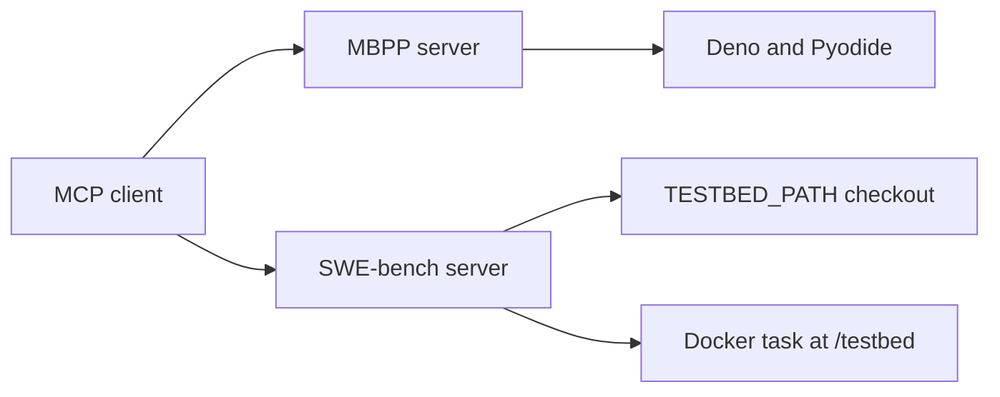

# MCP architecture

Both servers use FastMCP and support stdio and HTTP. An MCP client can call
them directly. Model-provider credentials belong to the agent.

## MBPP

`run_tests(code, test_list, test_imports=None)` starts a fresh Python runtime.
It executes imports, the solution and assertions in that order.

The tool returns a JSON string with `success` and `output`. Errors identify
`<test imports>`, `<solution>` or `<test N>` and include the submitted line.

| Default limit | Value |
| --- | --- |
| Execution time | 30 seconds after runtime startup |
| Whole Deno process memory | 512 MiB, monitored by a watchdog |
| Output | 8192 UTF-8 bytes |

Pass `--sandbox-config` at startup to load trusted limits. See the
[execution contract](mbpp-sandbox-contract.md) for supported imports and isolation.

## SWE-bench

The server starts with no task-file argument. See the [integration
contract](integration.md) for the task setup call and result handling.

1. Before `start_task`, file tools, `run_command` and `get_patch` use `TESTBED_PATH`.
2. `start_task(docker_image, eval_script)` creates a private Docker workspace.
3. Tools then use `/testbed`. Starting another task closes the previous session.

The six file tools read, edit, list and search files, locate definitions and
find references. `run_command` executes a shell command. Host commands use the
MCP process's permissions. Docker tasks have no network and a 128-process limit.

`run_tests()` evaluates a disposable workspace with the prepared dependencies.
It returns `stdout`, `stderr`, `exit_code`, `timed_out` and `truncated`.
Inspect the logs as well as the exit code. The evaluation script determines
whether a failed assertion produces a nonzero exit code.

`get_patch()` includes new files and rejects oversized patches. Server shutdown
cleans up task containers and temporary evaluation images.

## Code and ownership

- **MCP and execution** — Matvii Nesterenko (`kapustazh`, 42 login `mnestere`).
  `mcp_tools_mbpp.py`, `mcp_tools_swebench.py`, `src/mbpp_executor.py`,
  `runtime/mbpp.mjs`, `src/swebench_tools.py`, `src/swebench_docker.py`.
- **Agent** — Oleksandr Bachurin. `agent_mbpp.py`, `src/llm_connector.py`,
  `src/agent_utils.py`.
- **Sandbox** — Irek Iunusov. `sandbox.py`, `src/sandbox_worker.py`,
  `src/sandbox_security.py`.

`src/config_model.py` and `src/sandbox_template.json` define shared configuration.
The sandbox forwards MCP calls to the server. Its owner handles observations
and the `final_answer` integration.
